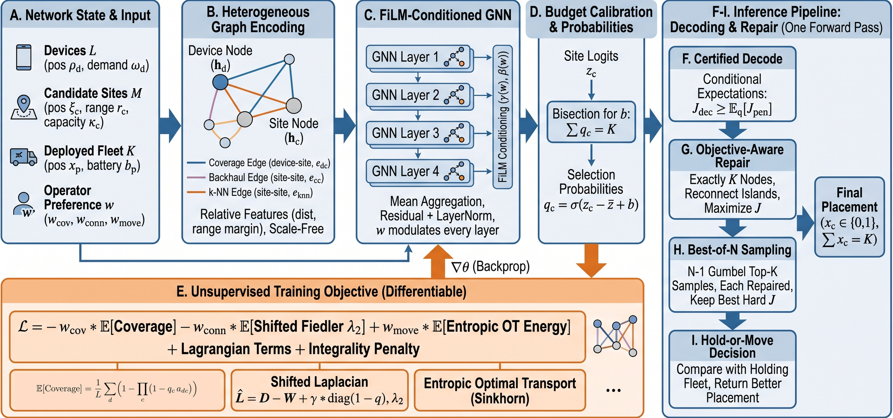

# PlaceGNN: amortised graph-neural optimisation for preference-steerable fog-node re-placement

Code, results and figures for the paper:

> A. H. Abdelhaliem, I. Altawaiha, H. Alshawabkeh, S. Askar and I. S. Fathi. *Amortised graph-neural optimisation for preference-steerable fog-node re-placement in dynamic IoT networks.* (under review, revision round 1)

PlaceGNN is a heterogeneous graph neural network that emits a fog-node placement in one forward pass. It is trained **without labels** on an expected objective of coverage, algebraic connectivity (a shifted Fiedler value) and optimal-transport movement energy, is **conditioned on operator preferences**, and decodes with conditional-expectation rounding, objective-aware connectivity repair and best-of-*N* sampling.



## Main findings (complete run on Kaggle, 2026-11)

| Setting | PlaceGNN | Best comparator |
|---|---|---|
| Dynamic re-placement, 180 trajectories (*J*) | 0.7661 | **LS-swap (*J*) 0.7762** (27x slower) |
| Decision latency (dynamic) | **0.16 s** | LS-swap (*J*) 4.4 s, WS-GA (*J*) 6.9 s |
| Preference satisfaction J_pref | 0.5270 | **LS-swap (*J*) 0.5487** (27x slower) |
| 15 preferences answered in | **1.9 s** | WS-GA (*J*) 74.6 s (39x longer) |
| Static placement, *K* = 100 (*J*) | 0.7960 | WS-GA 0.7986 (71x slower) |
| Zero-shot scalability (*J*, up to *K* = 5,000) | 0.794-0.797 | - |

**Headline.** Among methods that decide in under half a second, PlaceGNN gives the best or statistically tied objective in both the dynamic and the preference experiments. A warm-started genetic algorithm (WS-GA) and a swap local search (LS-swap) that search on the **exact** objective obtain a better placement, by 0.7-1.3% in *J*, at 27-43x the decision time. Three untrained-network seeds and a non-learned fleet-proximity score with the same decoder score 0.016-0.018 lower in the dynamic experiment and 0.033 lower in the preference experiment, so PlaceGNN's advantage comes from training.

## Repository layout

```
notebooks/
  PlaceGNN.ipynb                    # complete, resumable pipeline (training, every experiment, statistics, figures)
results/
  SUMMARY_FULL_run.txt              # one-line summary per experiment
  train_time_local.json             # wall-clock training time per model
  tables/*.csv                      # every table in the paper and the supplement (E1-E8, V0, R1_*)
  tables/R1_environment.json        # GPU, CPU, RAM, library versions, CBC settings of the reported run
  tables/per_instance/*.csv         # per-instance / per-trajectory raw results (released as reviewers requested)
figures/                            # Figures 1-3 of the paper
```

## Trained model weights

Weight files (`*.pt`, ~115 MB in total) are published as **release assets** of the tagged version of this repository (see the **Releases** page). The notebook loads them automatically when they are present at `MyDrive/PlaceGNN_runs/<RUN_NAME>/ckpt/<model>/stage1_final.pt`.

## Reproducing the results

1. Open `notebooks/PlaceGNN.ipynb` in Google Colab (*File -> Upload notebook*) or Kaggle; select a GPU runtime (Tesla T4 is sufficient).
2. Keep `MODE = "FULL"` in the first cell for the paper-scale run, or set it to `"QUICK"` for a ~2-minute smoke test.
3. *Runtime -> Run all*. Everything (training checkpoints and every experimental unit) is cached, so an interrupted session resumes where it stopped. A complete from-scratch run takes several free-tier sessions.

The reported run was executed on Kaggle with two NVIDIA Tesla T4 GPUs, an Intel Xeon CPU at 2.00 GHz, 31 GB of RAM, Python 3.13.16, PyTorch 2.11.0 (CUDA 13.0), NumPy 2.1.3, SciPy 1.16.3, pandas 2.3.3, Matplotlib 3.10.0 and PuLP 3.3.2 with CBC 2.10.3. Latencies of the dynamic and preference experiments were measured under parallel load (four processes); see Section 4.4 of the paper.

The EUA dataset (real Melbourne edge sites and users) is downloaded automatically from <https://github.com/PhuLai/eua-dataset>. All synthetic instances are generated deterministically from fixed seeds.

### Naming note
In the notebook code the warm-started Pelican optimisation baseline is labelled `D-POA`; in the paper it is called **WS-PeOA**, to avoid confusion with the published dynamic *pufferfish* optimiser D-POA (Abu-Ein et al., *Sci. Rep.* 2026). `(J)` after a baseline name marks the version that searches on the exact objective (added in revision round 1). `PlaceGNN (untrained)` is "Untrained network" in the paper and `PlaceGNN (fixed w)` is "PlaceGNN, fixed w".

## Requirements

Python >= 3.10 with the packages in `requirements.txt`. Colab and Kaggle provide all of them except `pulp==3.3.2`, which the notebook installs itself (version 3.3.2 is required: PuLP 4 changed the LP interface and no longer ships CBC).

## Citation

See [`CITATION.cff`](CITATION.cff).

## License

MIT. See [`LICENSE`](LICENSE).
