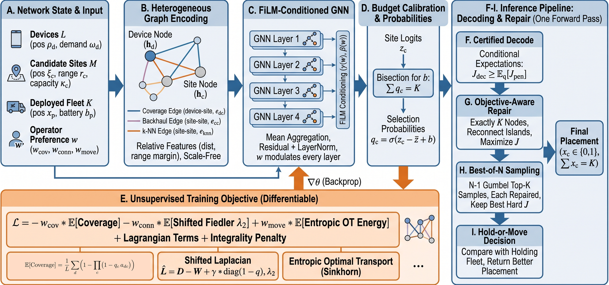

# PlaceGNN: amortised graph-neural optimisation for preference-steerable fog-node re-placement

Code, results and figures for the paper:

> A. H. Abdelhaliem. *Amortised graph-neural optimisation for preference-steerable fog-node re-placement in dynamic IoT networks.* (under review)

PlaceGNN is a heterogeneous graph neural network that emits a fog-node placement in one forward pass. It is trained **without labels** on an expected objective of coverage, algebraic connectivity (a shifted Fiedler value) and optimal-transport movement energy, is **conditioned on operator preferences**, and decodes with a derandomisation certificate, objective-aware connectivity repair and best-of-N sampling.



## Main findings (FULL run)

| Setting | PlaceGNN | Best comparator |
|---|---|---|
| Dynamic re-placement, 180 paired trajectories (J) | **0.7651** | WS-GA 0.7611 (Holm p = 3.0e-5) |
| Service disruption per trajectory | **180 s** | Greedy-CC 197 s |
| Preference satisfaction J_pref (best share) | **0.525 (90%)** | WS-GA 0.496 (60%) |
| Static placement, K = 100 (J) | 0.7954 | WS-GA 0.7986 (PlaceGNN is 56× faster) |

An untrained network with the same decoder loses the dynamic and preference advantages, so they are learned. On static instances the metaheuristics and a greedy heuristic remain slightly better; see the paper's Discussion.

## Repository layout

```
notebooks/
  PlaceGNN.ipynb                    # the complete, resumable pipeline (training, all experiments, statistics, figures)
  PlaceGNN_executed_FULL_run.ipynb  # the same notebook with the outputs of the FULL run reported in the paper
results/
  tables/*.csv                      # every table in the paper and its supporting information, per experiment
  SUMMARY_FULL_run.txt              # one-line summary per experiment
figures/                            # Figs 1-3 of the paper
```

## Reproducing the results

1. Open `notebooks/PlaceGNN.ipynb` in Google Colab (*File → Upload notebook*) and select a GPU runtime.
2. Keep `MODE = "FULL"` in the configuration cell (or set `"QUICK"` for a ~2-minute smoke test).
3. *Runtime → Run all* and approve Google Drive access. Everything (checkpoints and every experimental unit) is saved to `MyDrive/PlaceGNN_runs/<RUN_NAME>/`, so a disconnected session resumes where it stopped. A full run from scratch takes several free-tier sessions.

The EUA dataset (real Melbourne edge sites and users) is downloaded automatically from <https://github.com/PhuLai/eua-dataset>. All synthetic instances are generated deterministically from fixed seeds.

### Naming note
In the notebook code the warm-started Pelican optimisation baseline is labelled `D-POA`; in the paper it is called **WS-PeOA**, to avoid confusion with the published dynamic *pufferfish* optimiser D-POA (Abu-Ein et al., *Sci. Rep.* 2026). Likewise `PlaceGNN (untrained)` is "Untrained network" and `PlaceGNN (fixed w)` is "PlaceGNN, fixed w" in the paper.

## Requirements

Python ≥ 3.10 with the packages in `requirements.txt` (Colab provides all except `pulp`, which the notebook installs itself).

## Citation

See `CITATION.cff`. Please cite the paper if you use this code.

## Licence

MIT (see `LICENSE`).
